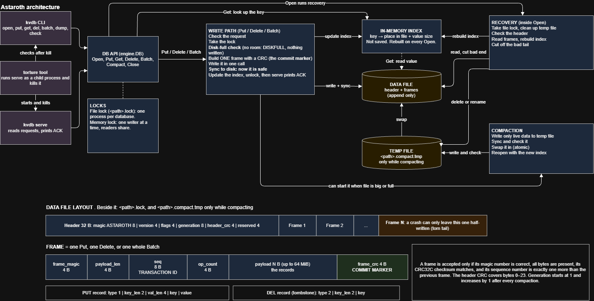

# Architecture and robustness proof

This document defends the design. `BREAKING.md` attacks it, and `README.md` explains how to build, run and test it. Everything here refers to the code as it is in this repository; where something is not verified, it says so.

**The design in one paragraph.** Astaroth is an append-only log with an in-memory hash index, in one data file. Every `Put`, `Delete` and `Batch` becomes exactly one *frame*: a header carrying a transaction id, the records, and a trailing CRC32C over all of it that serves as the **commit marker**. A frame is written with one `WriteAt` and made durable with one `Sync` (fsync); only then is the index updated and only then does the call return, so only then can `serve` print `ACK`. Recovery replays every frame whose commit marker validates and cuts off the one frame a crash can leave incomplete. Compaction writes the live data to a temporary file, syncs and verifies it, and swaps it in with one atomic replace. A file-size limit is checked before any byte is written.

## Part 1: Architecture diagram

The architecture diagram is included below. The editable source is the Draw.io file (`-Architecture.drawio`), and the exported image is stored alongside this Markdown file.

### Components and where they live

| Component | Code | Role |
|---|---|---|
| Client API | `src/engine/engine.go`: `Open`, `Put`, `Delete`, `Batch`, `Get`, `Len`, `Close`; `src/engine/inspect.go`: `Dump`, `Check`; `src/engine/compact.go`: `Compact` | Library interface |
| CLI and serve | `cmd/kvdb/commands.go`, `cmd/kvdb/serve.go` | Command-line interface and request handling |
| Write path | `src/engine/engine.go`: `appendLocked` | Handles database writes |
| Disk-full guard | `src/engine/compact.go`: `ensureRoomLocked`, `writeLimit`, `deleteReserve`, `compactedSize` | Checks available database space |
| Log writer and commit marker | `src/storage/frame.go`: `EncodeFrame`, `FrameReader.Next` | Writes and validates frames |
| In-memory index | `src/index/index.go`: `Apply`, `Get`, `Reserve`, `LiveBytes` | Maintains the in-memory key-value index |
| Recovery | `src/recovery/recovery.go`: `Recover`, `scanLog`, `recoverTornStart`, `Check`; `src/recovery/compaction.go`: `CleanupCompaction` | Rebuilds the index and handles incomplete writes |
| Compaction | `src/engine/compact.go`: `compactLocked`, `writeCompacted`, `verifyCompacted`, `maybeAutoCompactLocked`; `src/storage/replace_windows.go` and `replace_unix.go`: `ReplaceFile`, `SyncDir` | Rewrites the database with live records |
| Locks | `src/lock`: `Acquire`, `Release`; `DB.mu` in `src/engine/engine.go` | Controls database access |
| Fault injection for tests | `src/failpoint` | Simulates crashes at specific points |

## Part 2: Scenario-to-mechanism proof table

One row for every scenario of Groups A to F in the problem statement. "Where in the code" gives file and function. "Verified by" names the tests (in `tests/` unless noted; run one with `go test -run <Name> -v ./tests`) and the torture runs that exercise the scenario. The failpoint names (`append-after-sync` and so on) mark the exact line where a test makes the process die; the test runs a real child process that exits there without any cleanup, and then checks the recovered database against the operations the child had acknowledged.

Torture runs referred to below, all on the development laptop with 3 concurrent writers and zero violations: `./torture --iterations 500 --seed 12345` (normal mode, 114,332 acknowledged operations, every one of the 500 kills with operations in flight), and `--iterations 100 --seed 999` in each of `large-values`, `large-batches`, `recovery-crash`, `compaction` and `disk-full`. A seed fixes the kill delays; see "Caveats" for what it does not fix.

| Scenario | Disk state at the moment of the kill | Mechanism that handles it | Where in the code | Verified by |
|---|---|---|---|---|
| **A1** kill before any byte of a put reaches the file | earlier frames only; the new frame is encoded in memory but not written | the index is updated only after `Sync` (step 8), and nothing of the frame is on disk, so the key is absent or keeps its previous value after restart | `src/engine/engine.go` `appendLocked` (failpoint `append-before-write`, between `EncodeFrame` and `WriteAt`) | `TestKillDuringWritePath/A1` (killed at each of the first 9 writes; state equals exactly the acknowledged operations); torture normal, seed 12345 |
| **A2** kill after some bytes of the record (torn write) | a prefix of the frame: half of the 20-byte frame header, or half the frame; `payload_len` claims more bytes than the file holds, or `frame_crc` does not match | the commit marker: `FrameReader.Next` accepts a frame only if magic, length and CRC32C all check; `scanLog` stops at the first frame that does not; `Recover` truncates from there and syncs; the torn bytes are never indexed, so never returned | `src/storage/frame.go` `FrameReader.Next`; `src/recovery/recovery.go` `scanLog`, `Recover` | `TestKillDuringWritePath/A2` (failpoints `append-partial-header`, `append-partial-write`); `TestOpenAfterTruncationAtEveryByte` (log cut at every byte); `src/storage` `TestEveryTruncationIsTorn`, `TestEveryFlippedByteIsDetected`. Torture: real kills did not tear a write (see Caveats), so this is verified by the failpoint and truncation tests |
| **A3** kill after the record is fully written, before fsync | the complete frame, commit marker included, in the OS page cache, not yet fsynced; a process kill does not lose the page cache | the frame is self-validating, so recovery replays it in full (either outcome is allowed); nothing else is touched because writes only append at `end` | `appendLocked` (failpoint `append-after-write`, between `WriteAt` and `Sync`); `scanLog` | `TestKillDuringWritePath/A3` (accepts the acknowledged state with or without the in-flight op, nothing else); `TestKillDuringRecovery` ("complete frame never fsynced") |
| **A4** kill after fsync returns, before put returns | the complete frame, durable; index not yet updated; no ACK written | `Sync` returned, so the frame is on disk and recovery replays it: the key is present with the new value | `appendLocked` (failpoint `append-after-sync`, between `Sync` and `index.Apply`); `scanLog` | `TestKillDuringWritePath/A4` (the in-flight op must be present); torture normal seed 12345: 396 in-flight operations found applied in full, i.e. durable but not yet acknowledged when the kill came |
| **A5** kill immediately after put returns success | the complete frame, durable | `Put` returns only after `Sync`, so an acknowledged put is replayed | `Put` -> `appendLocked`; `serve.go` `reply` | `TestKillImmediatelyAfterSuccess` (child exits right after its last ACK, without `Close`); `TestCLIServeKilledRepeatedly` (real `Process.Kill` of `kvdb serve`, every ACKed op checked in `dump`); torture normal seed 12345 |
| **A6** kill during a delete | a tombstone frame (DEL record, 3 + key bytes) absent, torn, complete or durable; the key's old PUT record is untouched (append-only) | a delete is a frame like a put, so A1 to A5 apply: tombstone committed -> key absent; tombstone not committed -> old value intact. A delete of a missing key writes nothing | `src/engine/engine.go` `Delete`, `appendLocked`; `src/index/index.go` `Apply` (DEL case) | `TestKillDuringWritePath` (every fourth operation of the workload is a delete, killed at each write position); `TestConcurrentWritersKilledAtRandom` (a dedicated deleter); torture, all modes (15 to 30% deletes) |
| **A7** kill during a put of a 1 MB value | a frame of 24 + 7 + key + 1,048,576 bytes spanning many disk blocks; any prefix of it | the same frame rules: the CRC covers every byte of the value, so a partial 1 MiB value can never validate | `appendLocked`; `FrameReader.Next` | torture `--mode large-values --seed 999` (values up to 1 MiB, a quarter exactly 1 MiB; 100 kills with operations in flight; 35 in-flight puts found applied in full, 231 absent, none partial); `TestCLIServeLargeBinaryValue`; `src/storage` `TestMaxSizedOpsRoundTrip`. The failpoint tests use small values; the 1 MiB case is verified by torture only |
| **B1** kill after 3 of 10 operations of a batch are written | frame header and the first 3 records; no commit marker; the file ends before `payload_len` says the frame ends | the whole batch is one frame: incomplete -> not committed -> none of the 10 visible, and the tail is truncated | `src/engine/engine.go` `Batch`, `appendLocked` (failpoint `append-after-3-records`); `scanLog`, `Recover` | `TestKillDuringBatch/B1` (batch of 10, killed in each of 6 successive batches; recovered state must equal a whole number of batches); `TestKillDuringTenThousandOpBatch` |
| **B2** kill after all 10 records, before the commit marker | header and all 10 records; the 4 bytes of `frame_crc` missing | the frame is 4 bytes shorter than `payload_len` requires -> not committed -> none visible | `appendLocked` (failpoint `append-before-commit-marker`); `FrameReader.Next` | `TestKillDuringBatch/B2`; `TestBatchWithoutCommitMarkerIsAbsent` (a committed batch frame cut at every byte, including the cut that keeps every record and drops only the marker) |
| **B3** kill after the commit marker is written, before fsync | the complete frame, marker included, in the page cache | all or nothing: the marker validates only if all records are present, and then the whole frame is replayed | `appendLocked` (failpoint `append-after-write`) | `TestKillDuringBatch/B3` (state must be a whole number of batches) |
| **B4** kill after the batch returns success | the complete frame, durable | `Batch` returns only after `Sync` | `Batch` -> `appendLocked` | `TestKillAfterBatchAcknowledged`; `TestKillDuringBatch` ("after fsync, before acknowledgement": the batch must be present); torture normal seed 12345 (22,900 acknowledged batches) |
| **B5** a batch that puts X and deletes X | one frame with both records in order | ordering defined in README ("Batch semantics"): operations apply in list order, the last operation on a key wins, so `[put X, del X]` leaves X absent and `[del X, put X=v]` leaves X = v. Live writes and replay call the same `index.Apply`, in record order, so a crash cannot change the outcome | `src/index/index.go` `Apply`; `scanLog` | `TestBatchPutThenDeleteSameKey` (checked again after a restart); `TestBatchRepeatedKeys`; `src/recovery` `TestReplayOrderWithinAndAcrossFrames`; `src/index` `TestApplyOrderWithinFrame`; torture batches contain repeated keys and put/delete mixes |
| **B6** a batch of 10,000 operations killed halfway | a partial frame of a 10,000-record batch | as B1: not committed, none visible, tail truncated; recovery reads it once | `appendLocked`; `scanLog`, `Recover` | `TestKillDuringTenThousandOpBatch` (killed three ways; none visible; open plus 10,000 reads took 60 to 90 ms); torture `--mode large-batches --seed 999` (1,838 batches of up to 10,000 operations; slowest recovery 61 ms) |
| **C1** kill during open() while replaying the log | unchanged: replay only reads | `scanLog` never writes, so the next open replays the same bytes to the same state | `src/recovery/recovery.go` `scanLog` (failpoint `recover-replay-frame`) | `TestKillDuringRecovery` (killed after frame 1, 2 and 4, on 6 different starting files; the next open must give the same data and byte-identical file as an uninterrupted recovery); torture `--mode recovery-crash --seed 999` (182 kills during restart, 136 of them before recovery finished) |
| **C2** kill during open() while truncating or repairing a torn tail | torn tail still present (before `Truncate`), or cut but not synced, or cut and synced; or a header being written into an empty file | the only repairs are idempotent: truncate to the end of the last valid frame, and write the header when no frame can exist yet. Rerunning on any intermediate state reaches the same decision | `Recover` (failpoints `recover-before-truncate`, `recover-after-truncate`, `recover-after-truncate-sync`); `recoverTornStart` (`recover-before-header`, `recover-after-header`) | `TestKillDuringRecovery`; `TestRecoveryKilledRepeatedly`; `src/recovery` `TestRecoveryIsIdempotent`, `TestRecoveryRepeatedGivesIdenticalResult`; torture recovery-crash seed 999 |
| **C3** kill during compaction, before the new file replaces the old | the old data file complete and never modified; `<path>.compact.tmp` empty, partial, complete, or complete and verified | the old file is not touched until K6, so it is authoritative; the next open's `CleanupCompaction` deletes the temporary file | `src/engine/compact.go` `compactLocked` (failpoints `compact-start`, `compact-write-frame`, `compact-before-sync`, `compact-before-verify`, `compact-before-rename`); `src/recovery/compaction.go` `CleanupCompaction` | `TestKillDuringCompaction` (each point; afterwards the header generation is 1 and the file size is unchanged: the old file); `TestKillWhileWritingTemporaryFile` (after 1, 2 and 3 of 3 frames); torture `--mode compaction --seed 999` (1,045 compactions; 67 of the 100 kills landed while one was in flight) |
| **C4** kill during compaction, in the middle of the rename or swap | the swap is one system call: either still the old file plus the temporary file, or the new file and no temporary file | `ReplaceFile` is a single `MoveFileExW(MOVEFILE_REPLACE_EXISTING \| MOVEFILE_WRITE_THROUGH)` (Windows) or `rename(2)` (Unix): the path always names one complete file. If a replace were not atomic and left no data file but a complete temporary file, `CleanupCompaction` renames the temporary file into place: it is renamed only after K3 and K4, so it is complete | `src/storage/replace_windows.go` and `replace_unix.go` `ReplaceFile`; `compactLocked` (`compact-before-rename`, `compact-after-rename`); `CleanupCompaction` | both sides of the call: `TestKillDuringCompaction` (`compact-before-rename` -> old file; `compact-after-rename` -> new file); the non-atomic intermediate state, built by hand: `TestReplacementInterruptedBetweenRemoveAndRename`, `TestKillDuringCompactionCleanup`. A kill inside the operating system call itself cannot be produced by a test; atomicity of the call is an assumption about NTFS and Unix filesystems |
| **C5** kill during compaction, after the swap, before cleanup | the new file is the data file; the temporary file no longer exists (it was renamed); on Unix the directory may not be synced yet | there is nothing left to clean after the swap; any temporary file found next to a data file on open is from before a swap and is removed (if removal fails it is ignored, and the next compaction truncates it) | `compactLocked` (failpoints `compact-after-rename`, `compact-after-dir-sync`, `compact-done`); `CleanupCompaction` (`recover-before-tmp-remove`) | `TestKillDuringCompaction` (generation 2, smaller file, no temporary file left, all data intact); `TestKillDuringCompactionCleanup` (open killed while removing a temporary file); `TestCLICheck` (an abandoned temporary file is reported by `check` and removed by `open`) |
| **C6** kill during close() | every acknowledged frame is already fsynced; `Close` writes nothing: it calls `Sync`, closes the handle and releases the lock | close is not special: a kill anywhere in `Close` leaves the same bytes as a kill just before it, which is the state every other crash test starts recovery from | `src/engine/engine.go` `Close` | **not verified by a dedicated test** (there is no failpoint inside `Close`). Indirectly: every crash test kills or exits without calling `Close`, and `TestCLIServeSession` covers a clean `Close` at end of input |
| **D1** two writers putting different keys, killed at random | frames of both writers in the order they took L2; at most one frame (the one holding L2) incomplete | L2 (`DB.mu`) serializes the write path, so frames never interleave; each writer's ACK follows its own `Sync` | `src/engine/engine.go` `Put` and `appendLocked` under `DB.mu`; `cmd/kvdb/serve.go` `enqueue` (one goroutine per writer, so writers really run concurrently) | `TestConcurrentWritersKilledAtRandom` (two putters, a batch writer and a deleter in one child, `Process.Kill` after a random 80 to 480 ms, 15 iterations); torture normal seed 12345 (3 writers with separate key ranges; each writer's acknowledged state checked exactly) |
| **D2** two writers putting the same key, killed at random | two frames carrying different whole values for the key, serialized | a value lives in one record of one frame, so it is never mixed; the key holds the value of whichever frame was applied last | `appendLocked` under `DB.mu`; `index.Apply` | `TestConcurrentWritersKilledAtRandom` (shared key: the value must be one a writer sent, checked with a CRC inside the value); `TestConcurrencyStress`; torture seed 12345 (8 shared keys written by all writers) |
| **D3** one writer in a long batch, another doing single puts, killed at random | the batch's frame and the single puts' frames, one after another | the batch is one frame written under L2 (all or nothing, as B1 to B4); acknowledged single puts are separate durable frames | `Batch`, `Put`, `appendLocked` | `TestConcurrentWritersKilledAtRandom` (batch writer next to two putters); `TestConcurrentBatchesAndSinglePuts`; torture `--mode large-batches --seed 999` (batches of up to 10,000 operations next to single puts) |
| **D4** a reader calling get during a batch on the same keys (no crash) | not applicable (no crash) | the batch's operations are applied to the index all at once, under L2 held exclusively, after `Sync`; `Get` takes L2 shared, so it sees the state before or after, never in between | `src/engine/engine.go` `Get`, `appendLocked` (`index.Apply` under `DB.mu`) | `TestReadersNeverSeePartialBatch` (readers read the first and then the last key of a 10-key batch while 150 batches run; it fails with "half applied" when the lock is deliberately released mid-batch); `TestConcurrencyStress`; `go test -race ./...` reports no data race |
| **E1** file size cap reached during a single put | unchanged: the size check comes before any byte is written | the disk-full guard computes the frame size first and compares `end + size` with the limit; if compacting cannot make room the put returns `ErrDiskFull`; the database stays readable and later deletes still fit (the reserve) | `src/engine/compact.go` `ensureRoomLocked`, `writeLimit`, `deleteReserve`; called first in `appendLocked` | `TestPutRejectedAtLimit` (file unchanged, earlier keys intact, deletes still accepted); `TestDeletesAcceptedWhenFileIsExactlyFull`; `TestCLIServeDiskFull` (`ERR ... DISKFULL`, never `ACK`); torture `--mode disk-full --seed 999` (1,083 rejected writes, each checked to have had no effect) |
| **E2** cap reached halfway through a batch | unchanged: the whole frame's size is checked before writing | the batch is one frame, so the check covers all of it; a batch that does not fit is rejected whole, even if its first operations alone would fit. A real disk-full error during the write is rolled back with `Truncate(end)` | `ensureRoomLocked`; `appendLocked` (rollback; failpoint `append-disk-full`) | `TestBatchRejectedAtLimit` (32-operation batch over the limit: file byte-identical, none visible, also after restart); `TestDiskFullDuringWriteIsRolledBack` (real disk-full error halfway through a batch frame: no bytes left behind, batch absent) |
| **E3** cap reached, then the process is killed | file within the limit; only complete frames, since rejected writes left nothing | rejected writes never touch the file, so recovery is the ordinary case | `ensureRoomLocked`; `Recover` | `TestRestartAfterReachingLimit` (a child fills the database until a put is rejected and exits without `Close`; restart: all 59 acknowledged puts intact, limit still enforced); torture disk-full seed 999 (100 kills at the limit) |
| **E4** cap reached during compaction | old data file untouched; the temporary file stopped below the limit and is removed | the temporary file is capped at `MaxBytes` too; reaching it (or a real disk-full error) aborts before K6, removes the temporary file and leaves the old file as it was | `src/engine/compact.go` `writeCompacted` (limit check per frame; failpoint `compact-disk-full`), `compactLocked` (`abort`) | `TestCompactionFailsCleanlyAtLimit` (live data larger than the limit: compaction fails with `ErrDiskFull`, old file byte-identical); `TestDiskFullWhileWritingCompactedFile` |
| **E5** after deletes free up space, compaction runs, writes succeed again | after the deletes: the old file with dead records; after the compaction: a smaller file | deletes may use the reserve, so they fit in a full file; a write that does not fit triggers a compaction when the estimate says it would make room, then proceeds, with no manual step | `ensureRoomLocked`, `compactedSize`, `compactLocked` | `TestDeleteThenWriteAgainWithoutManualCompaction`; `TestDeleteCompactWriteAgain`; `TestOverwritesNeverPassTheLimit` (500 KiB of writes into a 64 KiB limit; compacted 9 times); torture disk-full seed 999 |
| **F1** 500 consecutive random kills and restarts | any of the states above | all of the above | all of the above | `./torture --iterations 500 --seed 12345`: 500 of 500 passed in 2m17s; 114,332 acknowledged operations; every kill with operations in flight |
| **F2** kill, restart, kill during recovery, restart, kill during recovery again | the states of C1 and C2, repeatedly | recovery reads only, except for the idempotent header write and truncation, and `CleanupCompaction` is idempotent too, so any number of interrupted recoveries leaves a file the next one handles the same way | `Recover`, `scanLog`, `recoverTornStart`, `CleanupCompaction` | torture `--mode recovery-crash --seed 999` (1 to 3 kills during every restart, 182 in total, 136 before recovery finished); `TestRecoveryKilledRepeatedly` (five interrupted recoveries in a row) |
| **F3** 1,000,000 keys written, process killed, open() called | a log of 1,000,000+ keys (59 MB), possibly with a torn tail | one sequential scan through reused buffers; the index map is sized once from a 1 MiB sample; recovery time grows with file size | `scanLog`; `src/storage/frame.go` `FrameReader`; `src/index/index.go` `Reserve` | **manual test**: 100 runs of `kvdb batch` with 10,000 puts each (1,000,000 keys, 59 MB); `kvdb serve` fed 3,000 more puts, `kill -9` after 1.2 s (1,946 ACKs); `kvdb open` three times: 322, 353 and 438 ms; `kvdb check` OK; `kvdb dump`: all 1,000,000 keys and all 1,946 acknowledged puts present. Also `TestRecoveryTimeOneMillionKeys` (medians 0.23 to 0.39 s on three shapes, 0.79 s for a 1 GB file) |
| **F4** database file truncated by 1 byte at the end by hand | the last frame missing the last byte of its `frame_crc` | the last frame is torn, so it is dropped and cut off; all earlier frames are intact | `FrameReader.Next`, `scanLog`, `Recover` | **manual test**: `kvdb put` a, b, c; `truncate -s -1`; `kvdb check` -> `OK keys=2 ... (torn tail: 32 bytes at offset 98, removed by the next open)`; `kvdb open` -> `keys=2 ... torn_tail_bytes=32`; `kvdb dump` -> a and b. Also `TestOpenAfterTruncationAtEveryByte` (every cut length, the last byte included). The record losing a byte is lost even if it had been acknowledged: the cut destroys it |

## Part 3: The three guarantees

### 1. Durability: once ACK is sent, the data survives

`serve` writes `ACK <id>` from one place, `reply`, and only when the engine call returned nil (`cmd/kvdb/serve.go`). `Put`, `Delete` and `Batch` return nil only from the end of `appendLocked`, and in `appendLocked` the order is fixed: one `WriteAt` (pwrite on Unix, `WriteFile` at an explicit offset on Windows) writes the whole frame, then `Sync` (fsync on Unix, `FlushFileBuffers` on Windows) must return without error, and only then is the index updated and the call allowed to return. So an ACK on stdout implies that the fsync covering every byte of that frame had already returned. After a restart, recovery replays every frame whose commit marker validates, and a synced frame validates. Nothing later removes it: recovery only truncates bytes after the last valid frame; compaction copies every live record and switches files only after `Sync` and verification of the new file, with one atomic replace; and the index only ever points at synced frames. If `Sync` fails, it is never retried (the OS may have dropped the data, so a retry could falsely report success): the handle refuses every later write, so no ACK can follow a failed fsync.

### 2. Atomicity: a batch is never half visible

A batch is one frame: one `EncodeFrame`, one `WriteAt`, one `Sync`. The commit marker is the frame's last 4 bytes, a CRC32C that `EncodeFrame` computes after everything else, over the frame header (transaction id, operation count, payload length) and every record. `FrameReader.Next` accepts a frame only if its magic is right, the file holds all `24 + payload_len` bytes, and the CRC matches; a frame missing any of its bytes (3 of 10 records, every record but not the marker) fails, so after a crash recovery applies either all of a batch's operations or none, and cuts the incomplete frame off. No fsync is needed between the records and the marker, because the marker is a checksum of the records, not a flag: its validity depends on every byte it covers, not on the order in which those bytes reached the disk. The size limit is checked against the whole frame before `WriteAt`, so a full disk cannot commit part of a batch either. While the process runs, the batch's operations are applied to the index in one step, after `Sync`, with `DB.mu` held exclusively; `Get` takes `DB.mu` shared, so a reader sees the state before the batch or after it. (A torn frame passing CRC32C by chance has a probability of about 2^-32.)

### 3. Recoverability: open() always succeeds on a file this database produced

A kill can leave only these shapes, and `Open` handles each one. (a) A compaction temporary file: next to a data file it is removed; without a data file it is renamed into place (`CleanupCompaction`). (b) A file shorter than its 32-byte header, from a kill during creation: if it is empty, zeros or a prefix of our header, the header is written and synced (`recoverTornStart`); no frame can exist yet, so nothing is lost. (c) A valid header followed by complete frames and at most one incomplete frame: writes are serialized by `DB.mu` and each one is synced before the next begins, so only the last frame can be in flight; `scanLog` stops at it and `Recover` calls `Truncate` to the end of the last valid frame, then `Sync`. The only writes recovery makes are that header write and that truncation, and both are idempotent: running recovery again on the state before, during or after either of them reaches the same result, so a kill during recovery is handled by the next recovery (C1, C2, F2; verified byte for byte by `TestKillDuringRecovery`). Compaction never modifies the old file and switches with a single `MoveFileExW` or `rename(2)`, so the data path always names a complete file (C3 to C5). `Open` refuses a file only for states no kill can produce: a wrong magic number or header checksum, a frame whose CRC is valid but whose contents are malformed, a gap in the transaction ids, or an invalid region larger than one maximum frame. It reports those and leaves the file untouched rather than guessing.

## Caveats

These are the limits of the argument above. `BREAKING.md` goes through them in more detail.

- **Process kill, not power loss.** All verification kills the process; the OS and disk are assumed honest, as the problem statement allows. The ordering is designed to hold across power loss too (fsync before ACK, a checksum as the commit marker, write-through or a directory fsync for the rename), but power loss was not tested. On Unix the directory is not fsynced after the data file is first created.
- **Torn writes come from tests, not from real kills.** On this machine the operating system completes a `write` call even when the process is being killed, so in the torture runs no kill tore a frame (every iteration reported a 0-byte torn tail). The kills did land inside operations: between `WriteAt` and `Sync`, or between `Sync` and the ACK (396 in-flight operations were found applied in full in the 500-iteration run). Torn frames are verified by the failpoint tests that write part of a frame and exit, and by the test that cuts a log at every byte.
- **What a torture seed reproduces.** A seed fixes every kill delay and the random choices of each writer, but the key chosen for some deletes depends on Go map iteration order, and later iterations depend on which in-flight operations survived; the operation stream is therefore not identical between two runs with the same seed. Every run's acknowledged operations are recorded in its `oracle.log`.
- **Atomic replace.** C4 relies on `MoveFileExW` with `MOVEFILE_REPLACE_EXISTING` being atomic on NTFS and on `rename(2)` being atomic on Unix filesystems. The NTFS behaviour is widely relied on but not formally documented; the "data file missing" rule in `CleanupCompaction` covers a replace that is not atomic.
- **Unix code paths** (`flock`, the `rename(2)` replace, the directory fsync) compile and pass `go vet` but have not been run; all verification is on Windows.
- **Batch size.** A batch must encode to at most 64 MiB, so 10,000 operations of 1 MB values do not fit in one batch; such a batch is rejected whole with `ErrBatchTooLarge` before anything is written.
- **C6** has no dedicated test (see its row).
